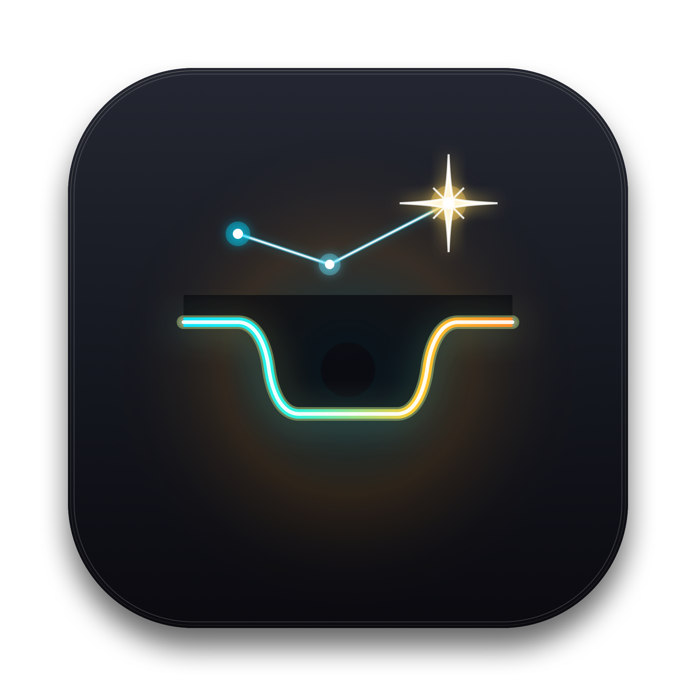

# Notchly

### Turn your MacBook notch into a living media island.

A lightweight macOS Dynamic Island, desktop constellation lyric visualizer, and ambient music companion built natively in Swift & SwiftUI.

 

[-000000?style=for-the-badge&logo=apple&logoColor=white)](https://www.apple.com/macos/)

 

  

---

## ⚡ What is Notchly?

Most MacBook notches just sit there. **Notchly** transforms the camera bezel into an Apple-grade Dynamic Island, turns your desktop into a celestial lyric visualizer, and surrounds your screen with sound-reactive neon lighting.

Built from scratch in pure Swift and SwiftUI with **zero external dependencies**, zero background battery drain, and **strictly zero microphone access**.

---

## ✨ Features That Feel Like Magic

### 🏝️ Precision Notch Dynamic Island
* **Hardware-Calibrated**: Sits flush alongside the MacBook camera notch, reserving the physical lens cutout with zero obstruction.
* **Spring Expansion**: Hover over the notch or hit <kbd>⌥ Option</kbd> + <kbd>N</kbd> to fluidly expand into a 480pt media hub.
* **Live Album Art**: Renders vibrant 46×46 rounded album artwork tiles with intelligent fallback badges.
* **Collapsed Notch Wings**: While closed, the left ear spins an animated vinyl record with the track's album art, while the right ear features real-time audio visualizer bars or your live focus countdown.
* **Interactive Timeline**: Real-time scrubbing, precise track position, and custom color accents extracted dynamically from each song's album palette.
* **Adjustable Calibration**: Fine-tune notch width, height, and horizontal offset via built-in sliders to match any MacBook model perfectly.

### 🌌 Desktop Constellation Lyrics
* **Celestial Lyric Mapping**: Projects synchronized LRC lyrics directly onto your desktop wallpaper as glowing star nodes linked by luminous constellation lines.
* **High-Contrast Typography**: The active singing word illuminates in 34pt bold typography with a dual black drop shadow for effortless legibility over light or dark wallpapers.
* **Bollywood & Noise Sanitization**: Cleans cluttered track titles (e.g. `(From "...")`, `[Remastered]`, `feat.`) to reliably locate lyrics for both Western and Bollywood/Hindi songs via lrclib.
* **60fps Time Interpolation**: Smooth local time interpolation advances lyric highlights at 60fps with zero AppleScript lag, backed by instant disk caching for 0ms repeat loads.

### ⚡ Sound-Reactive Beat Edge Glow
* **System Audio Beat Detection**: Analyzes live audio transients via macOS `ScreenCaptureKit` to pulse vibrant ambient light around the perimeter of your display in sync with the beat.
* **100% Privacy Guarantee**: Operates strictly on system audio output—Notchly **never** requests or accesses your physical microphone or screen video.
* **Palette-Matched Colors**: Automatically extracts the dominant vibrant hues from the current album cover to paint your screen edges in matching neon tones.

### 💽 Draggable Desktop Turntable
* **Wallpaper-Layer Platter**: A retro vinyl record player anchored gracefully directly above your desktop wallpaper.
* **Interactive Controls**: Drag the turntable anywhere on your screen; click the spinning record to play or pause.
* **Spinning Album Label**: The center label features the active track's cover art and rotates at 33⅓ RPM with an animated tonearm.

### 🎚️ Screen-Edge Volume & Brightness Sliders
* **Ambient Vertical Bars**: Sleek, non-intrusive glowing vertical sliders that appear on the screen edges whenever you adjust display brightness or system volume.

### ⏱️ 25-Minute Focus Timer (Pomodoro)
* **One-Click Focus**: Start, pause, and reset 25-minute Pomodoro sessions directly from the expanded notch pill bar.
* **Glanceable Wing Countdown**: Displays a discrete live countdown timer (`24:15`) in the collapsed notch wing while you work, playing a subtle glass chime at 00:00.

### 🔋 MagSafe & Battery HUD
* **Charging Alerts**: Displays a subtle MagSafe-inspired HUD alert (`⚡ Charging • 84%`) beneath the camera notch whenever AC power is connected or disconnected.
* **AirPods & Bluetooth Level**: Automatically displays connected headphone names and real-time battery percentages.

### 📊 Weekly Listening Diary
* **Listening Stats**: Tracks your weekly listening hours with an in-notch status pill and a diary of your recently played songs.

---

## ⌨️ Global Keyboard Shortcuts

Control your media system-wide from any app or fullscreen workspace:

| Shortcut | Action | Description |
| :--- | :--- | :--- |
| <kbd>⌥ Option</kbd> + <kbd>Space</kbd> | **Play / Pause** | Toggle playback in Spotify, Apple Music, or Browser media |
| <kbd>⌥ Option</kbd> + <kbd>→</kbd> | **Next Track** | Skip to the next song |
| <kbd>⌥ Option</kbd> + <kbd>←</kbd> | **Previous Track** | Return to previous song or restart current track |
| <kbd>⌥ Option</kbd> + <kbd>N</kbd> | **Toggle Notch** | Instantly expand or collapse the Notchly Dynamic Island |

---

## 🎧 Supported Music Sources

* **Spotify** (Desktop App)
* **Apple Music**
* **Safari & Google Chrome** (YouTube & YouTube Music tabs)

---

## 📥 Quick Installation (macOS 13+)

1. **Download**: Grab the latest **[Notchly.dmg](https://github.com/neerjain2008/Notchly/releases/latest)**.
2. **Install**: Open `Notchly.dmg` and drag the **Notchly** app icon into your **Applications** folder.
3. **First Launch (Gatekeeper)**:
   * Because Notchly is independently distributed, **Right-Click** (or Control-click) `Notchly.app` in `/Applications` and select **Open**.
   * Click **Open** in the macOS dialog. *(You only need to do this once)*.
4. **Grant Audio Access for Beat Glow**:
   * When prompted (or when toggling Beat Glow on), open **System Settings → Privacy & Security → Screen & System Audio Recording** and toggle **Notchly** to **ON**.
   * *Notchly uses this permission exclusively to analyze system audio output for the edge visualizer. It never accesses your microphone or records screen video.*
5. **Enjoy**: Play any song in Spotify, Apple Music, or YouTube and watch Notchly come alive!

---

Built by **Neer Jain** ([@neerjain2008](https://github.com/neerjain2008)) • All Rights Reserved.

